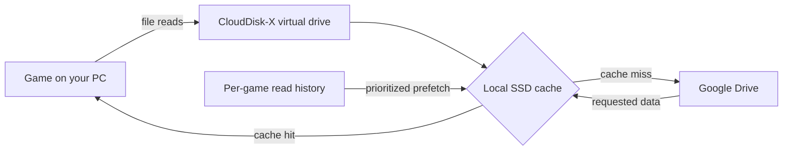

# CloudDisk-X

### Your game library in the cloud. The game still runs on your PC.

CloudDisk-X is an experimental Windows app that mounts cloud-stored game files as a virtual drive and uses a local
SSD cache to stream data as a game reads it. Its goal: keep large libraries in the cloud, without downloading every
game in full before you can try it.

<p align="center">
  <a href="https://github.com/XCyberThunder/cloud-disk"></a>
  <a href="https://dotnet.microsoft.com/"></a>
  <a href="LICENSE"></a>
  
</p>

> **Important:** CloudDisk-X is **not cloud gaming**. The game runs on your PC and uses your CPU and GPU. Uncached
> data depends on your internet connection; at 70 Mbps, the theoretical maximum is about 8.75 MB/s. This project is
> experimental, and commercial-game compatibility has not been established.

## How it works



CloudDisk-X mounts a cloud folder through **rclone + WinFsp**. Requested data is cached locally; per-game read
profiles help predict what to fetch next. You stay in control of your Google account through your own OAuth client.

## Features

| Feature | What it does |
|---|---|
| **Virtual drive** | Mount cloud files as a Windows drive letter, with an NTFS sparse-file cache. |
| **Google Drive** | Connect using your own OAuth client; sign-in happens in your browser and credentials are protected with Windows DPAPI. |
| **Configurable cache** | Choose a cache budget, pin files, monitor physical and logical usage, and protect free space for Windows. |
| **Adaptive prefetch** | Build per-game profiles and prioritize startup, transition, and sequential reads. Prediction can disable itself when accuracy is poor. |
| **Optimize & Prepare** | Measure your connection, prefetch predicted startup data within budget, and verify readiness against rclone's cache index. |
| **Game library** | Inspect installed games, check for missing DLL imports, and choose Cloud Direct, Hybrid Optimized, or Full Local mode. |
| **Live diagnostics** | Monitor throughput, cache hits/misses, read waits, stalls, prefetch accuracy, and errors. |
| **Safe lifecycle** | Reattach after app restarts, recover from crashes, and check mounts after sleep/resume. |
| **Game-Aware Mode (experimental)** | Optional telemetry protocol for authorized game integrations; no third-party game plugins are included. |

CloudDisk-X does not bypass DRM, anti-cheat, launchers, or game ownership checks. It does not delete cloud files.

## Benchmark snapshot

Measured with the DRM-free CPX demo game (54.5 MiB read across 409 reads), a simulated 70 Mbps / 80 ms link, and
rclone + WinFsp on an i3-10105F test PC. These are project-specific measurements, not a guarantee of performance.
See [BENCHMARKS.md](BENCHMARKS.md) for methodology and details.

| Scenario | Load time |
|---|---:|
| Local SSD | 0.09–0.12 s |
| Standard rclone mount, cold | 56.5–65.2 s |
| CloudDisk-X, cold, no profile | 20.3–21.0 s |
| CloudDisk-X, profiled + prepared (~32 s preparation), unseen level | 7.7–8.2 s |
| CloudDisk-X, fully cached | 0.15–0.27 s |

No commercial game has been tested. Check the current [compatibility notes](COMPATIBILITY.md) and
[known limitations](KNOWN_LIMITATIONS.md) before use.

## Getting started

### Requirements

- Windows 10 (version 1809 or later) or Windows 11, x64
- An NTFS drive for the local cache
- WinFsp (the setup installs the official signed package if it is missing)
- A Google OAuth client you configure yourself

### Install

The installer and portable packages are distributed through the project's GitHub Releases when a release is
available. The setup installs for the current Windows user; installing WinFsp is the only step that may request
administrator permission. The setup is not code-signed, so Windows SmartScreen may show a warning.

For a portable package, install WinFsp separately, extract the package, and run `Install.cmd`. You can also launch
`CloudDiskX.exe` directly from the extracted folder.

### First launch

1. Choose an NTFS cache folder, cache budget, and internet speed.
2. Open **Cloud Drives → Connect Google Drive** and follow the
   [Google Drive setup guide](docs/GOOGLE_DRIVE_SETUP.md).
3. Add a virtual drive and select your cloud games folder.
4. In **Game Library**, add a game that is already installed in that folder and review its compatibility report.
5. Launch once to stream on demand and collect a profile.
6. Before a later session, use **Optimize & Prepare** to prefetch the learned startup data.

Uninstall from **Settings → Apps → Installed apps → CloudDisk-X**. Settings, library, and cache are kept unless you
choose to remove them; cloud files are not touched.

## Build from source

Requirements: .NET 10 SDK and PowerShell. WinFsp is required for integration tests and real drive mounts.

```powershell
powershell -ExecutionPolicy Bypass -File installer/fetch-rclone.ps1
dotnet build CloudDiskX.slnx -c Release
dotnet test tests/CloudDiskX.Tests
```

Integration tests use rclone, WinFsp, and a local throttled server:

```powershell
dotnet test tests/CloudDiskX.IntegrationTests
```

Build a release package with:

```powershell
powershell -ExecutionPolicy Bypass -File installer/build-release.ps1
```

Integration tests need about 1 GB of free space on the repository drive (`.work/`). The end-to-end game test also
needs the demo game installed into its test dataset; see [TEST_REPORT.md](TEST_REPORT.md).

## Project docs

| Document | Description |
|---|---|
| [ARCHITECTURE.md](ARCHITECTURE.md) | Components and data flows |
| [BUILD_STATUS.md](BUILD_STATUS.md) | Implemented, tested, partial, and blocked work |
| [TEST_REPORT.md](TEST_REPORT.md) | Test results and environment |
| [BENCHMARKS.md](BENCHMARKS.md) | Measurement methodology and results |
| [COMPATIBILITY.md](COMPATIBILITY.md) | Tested filesystem features, apps, and games |
| [KNOWN_LIMITATIONS.md](KNOWN_LIMITATIONS.md) | Known restrictions |
| [Google Drive setup](docs/GOOGLE_DRIVE_SETUP.md) | Configure OAuth and connect an account |
| [Troubleshooting](docs/TROUBLESHOOTING.md) | Common problems and fixes |
| [Game-Aware protocol](docs/GAME_AWARE_PROTOCOL.md) | Authorized plugin telemetry protocol |
| [Third-party notices](THIRD_PARTY_NOTICES.md) | Licenses for bundled and referenced dependencies |

## Contributing and license

Contributions are welcome; see [CONTRIBUTING.md](CONTRIBUTING.md). CloudDisk-X is licensed under the
[MIT License](LICENSE). Third-party components retain their own licenses; see
[THIRD_PARTY_NOTICES.md](THIRD_PARTY_NOTICES.md). For security issues, follow [SECURITY.md](SECURITY.md).
